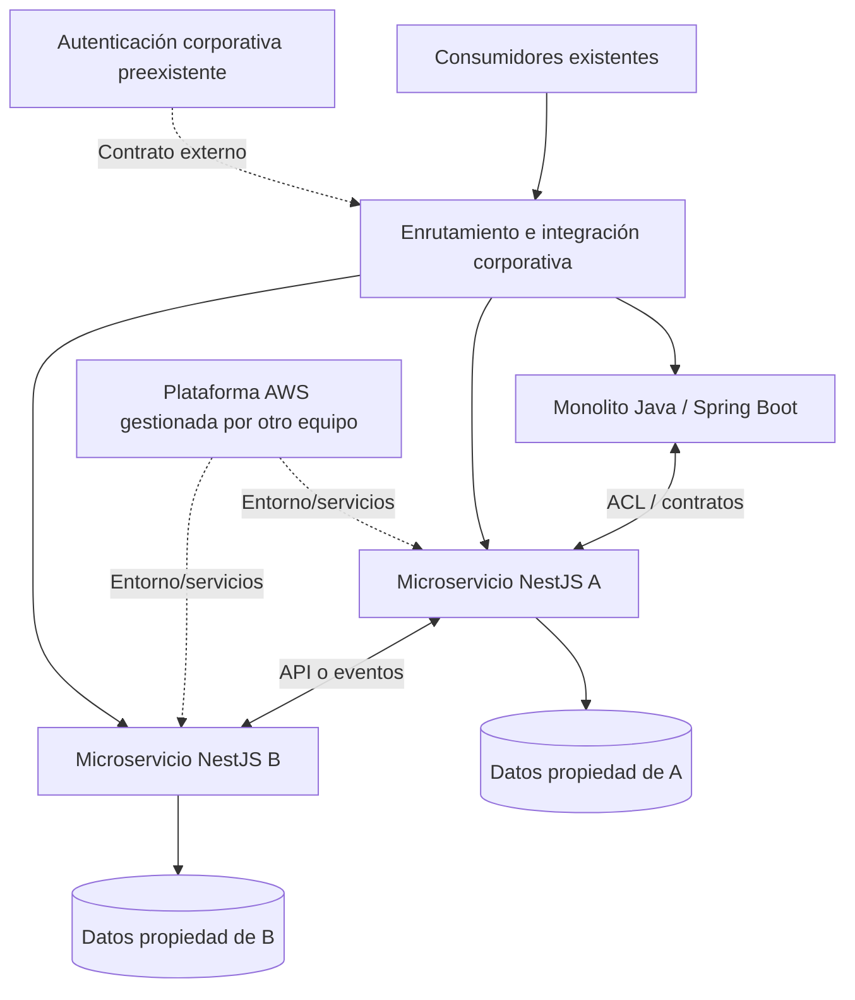

# Especificación base de arquitectura backend

**Proyecto:** Evolución de API monolítica Java/Spring Boot a microservicios NestJS/TypeScript  
**Enfoque:** Análisis del sistema actual, diseño objetivo y preparación de la migración  
**Versión:** 1.1.0 (alcance de seguridad actualizado)  
**Fecha:** 13 de noviembre de 2026  
**Estado:** Propuesta de referencia — requiere validación con el código y las restricciones corporativas

> **Propósito de este documento.** Establecer una base tecnológica, arquitectónica y metodológica para estudiar el monolito Java existente y preparar su evolución gradual hacia microservicios NestJS + TypeScript + MongoDB/Amazon DocumentDB, con librerías corporativas privadas y despliegue previsto en AWS.
>
> **Alcance de seguridad actualizado.** Se incluye el assessment, diseño y migración de las funcionalidades de **Spring Security** hacia mecanismos compatibles con NestJS, conservando los contratos de identidad, autenticación y autorización existentes hasta que se documenten y aprueben cambios. No se presupone ni se reemplaza unilateralmente un proveedor corporativo de identidad.
>
> **Exclusión vigente.** La estrategia de DevOps, CI/CD, infraestructura como código, aprovisionamiento y operación AWS corresponde al área AWS. Se documentan requisitos de integración, no se prescriben pipelines ni cambios de infraestructura.

---

## 1. Objetivos y alcance

### 1.1 Objetivo general

Definir criterios de arquitectura de software para evaluar el estado actual de una API monolítica desarrollada en Java/Spring Boot y construir un plan de migración incremental hacia componentes backend independientes con NestJS/TypeScript, preservando comportamiento funcional, integridad de los datos y compatibilidad de contratos.

### 1.2 Objetivos específicos

1. Identificar módulos, capacidades de negocio, dependencias, consumidores y reglas existentes en el monolito.
2. Detectar límites de dominio (*bounded contexts*) y candidatos a extracción.
3. Definir la estructura interna de referencia de los nuevos servicios.
4. Establecer decisiones sobre persistencia, comunicación, contratos, errores y resiliencia.
5. Seleccionar tecnologías y librerías para desarrollo, documentación, calidad y observabilidad de aplicaciones.
6. Establecer una estrategia verificable de migración, pruebas de paridad y retirada progresiva de funcionalidades legacy.
7. Producir especificaciones reutilizables en un flujo SDD (Specification-Driven Development) y revisables mediante ADR.

### 1.3 Dentro del alcance

- Arquitectura de aplicación y de dominio.
- Diseño de microservicios y sus límites.
- Estructura de código NestJS y convenciones TypeScript.
- MongoDB/DocumentDB: modelo, acceso, compatibilidad y propiedad de datos.
- APIs REST y comunicación síncrona/asíncrona entre componentes.
- Librerías corporativas y estrategia multirepositorio.
- Manejo de errores, confiabilidad, idempotencia, pruebas y observabilidad **dentro de la aplicación**.
- Inventario técnico y plan incremental de extracción.
- Assessment y migración de Spring Security: filtros, cadenas de seguridad, autenticación, autorización, roles/permisos, JWT/OAuth2/OIDC cuando apliquen, sesiones, políticas, excepciones y pruebas de paridad.

### 1.4 Fuera del alcance

- Diseño de despliegues, pipelines, contenedorización, IaC, redes, cuentas AWS, operación cloud y gestión de secretos.
- Selección definitiva de servicios AWS administrados sin aprobación del área responsable.
- Reingeniería funcional del negocio sin aprobación explícita.

**Límite de integración:** se analizará la configuración real de Spring Security y sus proveedores de identidad. La migración implementará los controles equivalentes en NestJS, integrándose con el proveedor corporativo vigente si existe. Cambiar dicho proveedor requiere una decisión explícita. La administración de AWS sigue fuera de alcance.

---

## 2. Principios de arquitectura

| ID | Principio | Regla verificable |
|---|---|---|
| ARQ-01 | Diseño orientado al negocio | Delimitar servicios por capacidad de negocio o bounded context, no por clase, tabla o endpoint. |
| ARQ-02 | Migración incremental | Mantener convivencia controlada entre monolito y servicios nuevos mediante Strangler Fig. |
| ARQ-03 | Independencia de dominio | El dominio no importa NestJS, Mongoose, drivers, AWS SDK ni DTO HTTP. |
| ARQ-04 | Dependencias hacia el interior | Las implementaciones concretas dependen de contratos del dominio/aplicación, no al revés. |
| ARQ-05 | Propiedad de los datos | Un único propietario de escritura por entidad/dato; prohibir acceso directo de un servicio a las colecciones de otro. |
| ARQ-06 | Contratos explícitos | Versionar y probar contratos API y de eventos. |
| ARQ-07 | Compatibilidad demostrada | Validar las características utilizadas de MongoDB contra la versión real de DocumentDB objetivo. |
| ARQ-08 | Resiliencia explícita | Establecer timeout, políticas de reintento, idempotencia y manejo de fallas cuando aplique. |
| ARQ-09 | Observabilidad por defecto | Generar logs estructurados, métricas y trazas correlacionables en el código. |
| ARQ-10 | Complejidad justificada | Adoptar CQRS, Saga, Kafka, Event Sourcing u otros patrones solo con caso de uso y ADR. |
| ARQ-11 | Librerías mínimas y estables | Compartir infraestructura transversal y contratos necesarios; evitar un dominio corporativo común altamente acoplado. |
| ARQ-12 | Paridad medible | Comparar respuestas, reglas y efectos sobre los datos antes de transferir tráfico. |

### 2.1 Estilos y patrones seleccionados

- **Arquitectura de microservicios:** estilo objetivo cuando existan límites de negocio y autonomía real. No implica fragmentar de forma obligatoria todos los módulos.
- **DDD estratégico:** discovery, subdominios, *bounded contexts*, *context mapping* y lenguaje ubicuo.
- **DDD táctico:** entidades, value objects, agregados, servicios y eventos de dominio donde aporten claridad.
- **Arquitectura hexagonal (Ports & Adapters):** desacoplar lógica de negocio y efectos externos.
- **Clean Architecture:** aplicar la regla de dependencias; **no crear estructuras duplicadas** para Hexagonal y Clean.
- **SOLID:** criterios de diseño de componentes y clases.
- **Vertical slice:** agrupar código por módulo/capacidad, con capas internas por módulo cuando corresponda.
- **Strangler Fig + Anti-Corruption Layer (ACL):** convivencia y traducción entre modelos legacy y nuevos.

**No son patrones universales:** CQRS, Saga, Transactional Outbox, Circuit Breaker y Specification Pattern se seleccionarán por la naturaleza y los riesgos de cada flujo.

---

## 3. Stack tecnológico objetivo

> La tabla es una línea base **propuesta**, no una lista de dependencias que deban instalarse todas. La versión exacta de cada componente deberá fijarse tras revisar compatibilidad, soporte corporativo y matriz de versiones del proyecto.

| Área | Propuesta | Decisión / criterio |
|---|---|---|
| Lenguaje | TypeScript con `strict: true` | Estándar objetivo. |
| Runtime | Node.js versión LTS aprobada | No fijar un número sin matriz de soporte institucional. |
| Framework | NestJS | Estándar objetivo de aplicación. |
| Package manager | pnpm | Preferido; versiones controladas. |
| HTTP adapter | Express | Elegir según compatibilidad del ecosistema y necesidades existentes; no cambiar por rendimiento supuesto. |
| API | REST + OpenAPI 3.x | Contratos explícitos y versionables. |
| Validación | `class-validator`/`class-transformer` o Zod | Elegir una convención principal por servicio/plataforma. |
| Persistencia documental | MongoDB / Amazon DocumentDB | La plataforma concreta debe confirmarse. |
| Modelo de persistencia | Mongoose o driver oficial | Mongoose preferente si las funciones usadas son compatibles con DocumentDB. |
| Testing unitario | Vitest | Preferir la herramienta ya estandarizada. |
| HTTP/e2e | Supertest o equivalente | Prueba de contratos HTTP. |
| Integración | Testcontainers y entorno DocumentDB real | MongoDB local no sustituye el test de compatibilidad DocumentDB. |
| Contract tests | OpenAPI diff / Pact según uso | Validar consumidores y proveedores. |
| Calidad | ESLint + Prettier + SonarQube | Alinear con la plataforma existente. |
| Logging | Logger corporativo `@gs/logger`| Estructurado y sin datos confidenciales. |
| Telemetría | OpenTelemetry | Instrumentación de aplicación independiente de backend. |
| Mensajería | AWS SDK v3 + adaptadores; SQS/EventBridge como candidatos | Confirmar junto con el área AWS; no son dependencias obligatorias. |
| Documentación | Markdown + ADR + C4 + OpenAPI | Artefactos versionados junto al código. |
| Especificaciones | OpenSpec / SDD | Proceso opcional, sujeto a estándares del equipo. |

### 3.1 Criterios para aprobar dependencias

- ¿Está mantenida y es compatible con la versión aprobada de Node.js/NestJS?
- ¿Su licencia y riesgos de cadena de suministro son aceptables?
- ¿Es compatible con la versión real de DocumentDB cuando interviene persistencia?
- ¿Introduce dependencias del framework en el dominio?
- ¿Duplicaría una librería corporativa disponible?
- ¿Existe un plan de actualización y reemplazo?

---

## 4. Modelo arquitectónico de referencia

### 4.1 Vista conceptual



**Nota:** este esquema es lógico, no una topología AWS ni un diseño de red. La implementación del enrutamiento, de los recursos de mensajería y del despliegue queda bajo las decisiones de las áreas responsables.

### 4.2 Estructura de un microservicio

```text
microservice-dvs-users/
├── src/
│   ├── modules/
│   │   └── users/
│   │       ├── domain/
│   │       │   ├── entities/
│   │       │   ├── value-objects/
│   │       │   ├── aggregates/
│   │       │   ├── events/
│   │       │   ├── services/
│   │       │   └── repositories/       # Puertos de dominio, cuando apliquen
│   │       ├── application/
│   │       │   ├── use-cases/
│   │       │   ├── ports/
│   │       │   └── dto/                # DTO internos de casos de uso
│   │       ├── infrastructure/
│   │       │   ├── persistence/
│   │       │   │   └── mongoose/
│   │       │   │       ├── schemas/
│   │       │   │       ├── mappers/
│   │       │   │       └── repositories/
│   │       │   ├── messaging/
│   │       │   └── external-services/
│   │       ├── presentation/
│   │       │   └── http/
│   │       │       ├── controllers/
│   │       │       ├── requests/
│   │       │       └── responses/
│   │       └── users.module.ts
│   ├── shared/                       # Solo utilidades técnicas locales
│   ├── app.module.ts
│   └── main.ts
├── test/
│   ├── unit/
│   ├── integration/
│   ├── contract/
│   └── e2e/
├── docs/
│   ├── adr/
│   ├── architecture/
│   ├── api/
│   └── migration/
├── AGENTS.md
├── package.json
├── tsconfig.json
└── README.md
```
**Regla de nombrado de microservicio:** el nombre debe empezar con el prefijo `microservice-dvs-*`. El `*` es el nombre representativo de las funcionalidades del propio servicio o del módulo de negocio (`domain`), por ejemplo: `core`, `tef`,`users`, `catalogs`, `auth`, `security`, etc.

### 4.3 Reglas por capa

| Capa | Puede contener | No debe contener |
|---|---|---|
| `domain` | Invariantes, entidades, agregados, eventos de dominio, reglas puras | Imports de NestJS, Mongoose, AWS SDK, controllers, schemas de base de datos |
| `application` | Casos de uso, orquestación y puertos externos | Consultas a Mongoose, lógica HTTP y configuración AWS |
| `infrastructure` | Adaptadores concretos de persistencia, mensajería, servicios externos y mappers | Reglas de negocio que deberían permanecer en dominio |
| `presentation` | Controllers, request/response DTO, validación de entrada y serialización | Acceso directo a base de datos o reglas complejas de negocio |

**Regla de composición:** los puertos se declaran en las capas internas y los adaptadores se conectan en `*.module.ts` mediante tokens de inyección de NestJS. Una interfaz TypeScript no es un token de inyección en runtime.

### 4.4 Ejemplo mínimo de puerto

```ts
// domain/repositories/customer.repository.port.ts
export interface CustomerRepository {
  findById(id: string): Promise<Customer | null>;
  save(customer: Customer): Promise<void>;
}

// application/ports/tokens.ts
export const CUSTOMER_REPOSITORY = Symbol('CUSTOMER_REPOSITORY');
```

La implementación Mongoose pertenece a infraestructura; el caso de uso solo conoce el contrato y su token de composición.

---

## 5. Estrategia de repositorios y librerías privadas

### 5.1 Estrategia preferente: multirepo + paquetes privados

```text
microservice-dvs-users      # Repositorio / ciclo de vida independiente
microservice-dvs-tef        # Repositorio / ciclo de vida independiente
microservice-dvs-auth       # Repositorio / ciclo de vida independiente
microservice-dvs-core       # Repositorio / ciclo de vida independiente
microservice-dvs-digital    # Repositorio / ciclo de vida independiente
gs-auth                     # Librería privada
gs-crypto                   # Librería privada
gs-documentdb               # Librería privada
gs-errors                   # Librería privada
gs-logger                   # Librería privada
microservice-dvs-template   # Estructura, convenciones y ejemplos
```

**La elección debe validarse contra la organización actual:** si existe un monorepo con gobierno maduro, no es necesaria una migración de repositorios únicamente para adoptar microservicios.

### 5.2 Paquetes corporativos

| Paquete ilustrativo | Versión | Responsabilidad permitida |
|---|--- |---|
| `@gs/auth` | `0.1.1` | Proporciona autenticación y autorización para aplicaciones NestJS. Incluye módulos y guards para JWT, Okta, roles y aplicaciones de comercio, además de estrategias, decoradores y manejo de expiración de tokens. No se importa directamente en el código fuente actual; es una dependencia corporativa disponible para el servicio. |
| `@gs/crypto` | `0.1.1`| Centraliza funciones criptográficas para proteger información. Expone cifrado simétrico y asimétrico, PGP, hash, HMAC, gestión de llaves, interceptores, guards y decoradores para cifrar o descifrar solicitudes y respuestas. En este servicio se usa para el cifrado de valores y mediante `UseEncryptionV2`, `EncryptionMethod` y `AsymmetricCryptoService`. |
| `@gs/documentdb` | `0.1.1` | Integra NestJS/Mongoose con Amazon DocumentDB, incluyendo configuración de conexión, soporte de certificado SSL, lectura de configuración y servicios asociados. El módulo se importa desde `src/app.module.ts`. |
| `@gs/errors` | `0.1.1` | Estandariza errores HTTP y su tratamiento. Incluye excepciones personalizadas —por ejemplo, bad request, not found, unauthorized, no content e internal server error—, códigos de error y un filtro de excepciones HTTP. Se usa en controladores, validaciones, mappers y filtros del servicio. |
| `@gs/health` | `0.1.1` | Agrega endpoints y módulos de health checks y status para exponer el estado de salud de la aplicación. El módulo se integra en `src/modules/common/common.module.ts`. |
| `@gs/logger` | `0.1.1` | Proporciona logging y monitoreo de la aplicación. Incluye módulo de monitoreo, servicio de logger, transports para consola y HTTP, correlación de solicitudes y capacidades para enviar logs a servicios de AWS/S3. Se usa en `src/main.ts` y `src/app.module.ts`. |
| `@gs/proxy` | `0.1.1` | Implementa capacidades para autenticación y comunicación mediante un proxy corporativo. Incluye guards, interceptor, servicio de proxy, gestión de credenciales, configuración y excepciones relacionadas con tokens y autenticación. Se usa en los controladores mediante `ProxyAuthGuard` y en la configuración Swagger. |
| `@gs/swagger` | `0.1.2` | Contiene utilidades corporativas para documentar APIs con Swagger/OpenAPI: decoradores, constantes y esquemas estandarizados de respuestas exitosas y de error. Se usa en los decoradores y configuración Swagger del servicio. |
| `@gs/utils` | `0.1.1` | Reúne utilidades reutilizables para aplicaciones corporativas, como validaciones, transformación y clonación de objetos, manejo de strings, números y JSON, generación de códigos y tokens, diferencias entre objetos, procesamiento de streams y servicios relacionados con listas negras. Es una dependencia transversal de varios paquetes corporativos. |
| `@gsa/decorators` | `~0.0.7` | Proporciona decoradores personalizados para validación y transformación de datos en NestJS, incluyendo validaciones comunes de espacios, enteros, números como string, opcionalidad y valores booleanos, además de decoradores de QA para strings y números requeridos u opcionales. |

**Seguridad como capacidad transversal:** evaluar si los adaptadores de validación de tokens, guards, políticas y contexto de identidad deben formar parte de una librería corporativa propia. Mantener separadas autenticación y autorización; no inventar interfaces ni proveedores sin verificar el código Java y acuerdos corporativos.

### 5.3 Reglas de consumo de librerías

1. Aplicar Semantic Versioning y fijación reproducible de dependencias.
2. Prohibir imports internos no públicos entre paquetes.
3. Evitar un paquete `common` que acumule entidades, DTO de todos los dominios y lógica compartida.
4. Probar compatibilidad de paquetes con cada versión soportada de NestJS/Node.js.
5. Definir política de deprecación y migración de cambios mayores.
6. Preferir contratos estables, explícitos y mínimos frente a clases base abstractas complejas.

---

## 6. Persistencia: MongoDB y Amazon DocumentDB

### 6.1 Consideración central

Amazon DocumentDB es un servicio compatible con determinadas APIs de MongoDB, **no un motor MongoDB idéntico**. No se debe asumir soporte por el nombre de una característica ni por los resultados de pruebas ejecutadas solo contra MongoDB.

### 6.2 Patrón de persistencia

- Adoptar **Database per Service** como principio de propiedad lógica de datos.
- No permitir consultas ni escrituras directas a colecciones de otro bounded context.
- Encapsular Mongoose/driver en adaptadores de infraestructura.
- Mantener schemas de persistencia separados de entidades de dominio.
- Transformar persistencia ↔ dominio mediante mappers explícitos.
- Definir índices y estrategias de consulta conforme a patrones de acceso reales.
- Decidir por caso si la separación será por colección, base lógica o clúster; no asumir un clúster por microservicio.
- Evitar transacciones distribuidas entre microservicios.

### 6.3 Matriz obligatoria de compatibilidad

Registrar para cada operación actual:

| Característica | Uso en Java actual | Versión fuente MongoDB | Compatibilidad DocumentDB objetivo | Prueba requerida | Resultado |
|---|---|---|---|---|---|
| Aggregation Pipeline | Por levantar | Por levantar | Pendiente | Casos reales y carga | Pendiente |
| Índices únicos/compuestos | Por levantar | Por levantar | Pendiente | Creación, errores, consultas | Pendiente |
| Transacciones | Por levantar | Por levantar | Pendiente | Atomicidad y fallas | Pendiente |
| Change Streams | Por levantar | Por levantar | Pendiente | Reanudación/duplicados | Pendiente |
| Retryable writes | Por levantar | Por levantar | Pendiente | Matriz por versión de motor | Pendiente |
| Collation/operadores | Por levantar | Por levantar | Pendiente | Consultas críticas | Pendiente |
| TTL / expiración | Por levantar | Por levantar | Pendiente | Comportamiento y tiempos | Pendiente |
| Bulk writes | Por levantar | Por levantar | Pendiente | Atomicidad parcial y errores | Pendiente |

No adoptar opciones del driver (p. ej., `retryWrites`) sin verificar el comportamiento de la versión y configuración DocumentDB a utilizar.

### 6.4 Estrategia de migración de datos

1. Identificar el sistema propietario de escritura y el ciclo de vida de cada dato.
2. Localizar colecciones compartidas por módulos y consultas entre dominios.
3. Definir contratos para lectura/escritura durante la convivencia.
4. Planear backfill, sincronización temporal, reconciliación y corte.
5. Especificar reglas de transformación, deduplicación y corrección de inconsistencias históricas.
6. Mantener criterios de verificación y reversibilidad antes del cambio de propietario.

**Riesgo principal:** que el monolito y un microservicio nuevo escriban simultáneamente el mismo dato sin coordinación; esto puede generar divergencias imposibles de resolver por una mera comparación de respuestas HTTP.

---

## 7. Contratos e integración entre servicios

### 7.1 Regla de selección

| Necesidad | Mecanismo candidato | Regla |
|---|---|---|
| Consulta o comando con respuesta inmediata | REST/HTTP o gRPC | Minimizar cadenas síncronas y establecer timeout. |
| Trabajo diferido | Cola de mensajes | Procesamiento al menos una vez; diseñar consumidor idempotente. |
| Evento de negocio publicado a múltiples consumidores | Bus de eventos / fan-out | Contrato versionado y evolución compatible. |
| Flujo de larga duración | Orquestación o Saga | Justificar con riesgo, compensaciones y consistencia. |

**Servicios específicos AWS:** SQS, SNS, EventBridge o Step Functions son *candidatos*, no selección impuesta; el equipo AWS define su disponibilidad y operación.

### 7.2 Contratos API

- Definir OpenAPI como fuente de referencia de las APIs REST.
- Documentar códigos HTTP, errores funcionales, validaciones, paginación, filtrado y ordenamiento.
- Separar DTO de transporte y modelo de dominio.
- Definir política de compatibilidad hacia atrás y versionamiento.
- Especificar comportamiento ante solicitudes repetidas, latencias y dependencia no disponible.
- Identificar la configuración real de Spring Security y el origen del contexto de identidad; especificar su migración con paridad funcional y validación de seguridad.

### 7.3 Contratos de eventos

N/A

### 7.4 Patrones de confiabilidad

- **Idempotencia:** no duplicar cambios de negocio ante un reintento.
- **Timeout y reintentos:** limitar duración, aplicar backoff y evitar reintentos indiscriminados de operaciones no idempotentes.
- **DLQ:** disponer de ruta operativa para mensajes no procesables cuando el transporte lo permita.
- **Transactional Outbox:** implementar cuando exista riesgo de persistir un cambio y perder su evento. Validar transacción y publicación con DocumentDB real.
- **Circuit Breaker / Bulkhead:** aplicar en dependencias que puedan provocar falla en cascada.
- **Saga:** documentar transacciones locales, compensaciones y casos irreversibles.

### 7.5 Cuándo NO aplicar ciertos patrones

- No utilizar CQRS solo por tener métodos `GET` y `POST`.
- No implementar Event Sourcing sin un requerimiento explícito de histórico, reconstrucción y operación.
- No transformar cada método interno en una llamada entre microservicios.
- No realizar *dual write* monolito↔microservicio sin mecanismo de consistencia definido.

---

## 8. Calidad, pruebas y observabilidad de aplicación

### 8.1 Pirámide de pruebas

| Nivel | Objeto | Herramienta orientativa | Criterio |
|---|---|---|---|
| Unitarias | Entidades, value objects, reglas y casos de uso | Vitest/Jest | Deterministas, sin dependencias externas. |
| Integración | Repositorios, adaptadores y mappers | Testcontainers, entornos controlados | Verificar persistencia y contratos reales. |
| Compatibilidad BD | Operadores/consultas existentes | Entorno DocumentDB real | Bloqueante ante incompatibilidades. |
| Contrato | Consumidor/proveedor API y eventos | OpenAPI/Pact | No romper consumidores sin acuerdo. |
| End-to-end | Flujos relevantes | Supertest/herramientas HTTP | Paridad funcional y de errores. |
| Rendimiento | Carga/concurrencia/latencia | k6 o equivalente | Cumplir NFR definidos. |
| Resiliencia | Fallas de dependencia/reintentos | Inyección controlada de errores | Recuperación y ausencia de duplicados. |

La cobertura de código puede adoptar un objetivo interno (p. ej., 80%) pero **no sustituye pruebas de comportamiento, contratos ni controles de integración**.

### 8.2 Reglas estáticas y diseño

- TypeScript estricto; evitar `any` sin justificación.
- ESLint/Prettier y revisión de complejidad ciclomática.
- Revisar que `domain` no dependa de paquetes técnicos.
- Revisar ausencia de acceso directo a repositorios en controllers.
- Revisar que los errores de dominio no dependan de HTTP.
- Mantener calidad de SonarQube conforme a criterios corporativos.

### 8.3 Observabilidad de aplicación

- Logs estructurados con nombre del servicio, entorno, evento, `requestId` y `traceId` cuando existan.
- Tracing distribuido mediante OpenTelemetry y propagación de contexto entre HTTP/mensajes.
- Métricas de errores, tiempo de respuesta, operaciones de negocio y salud de dependencias.
- Sanitización de payloads y exclusión de información sensible de logs.
- Catálogo de fallas y códigos de error estable para soporte.

El almacenamiento, visualización y operación del sistema de observabilidad pertenece a las plataformas corporativas correspondientes. Aquí solo se define lo que el software emite.

---

## 8A. Seguridad empresarial — migración de Spring Security a NestJS

> **Cambio de alcance 1.1.0:** la seguridad de aplicación sí forma parte de la migración. Debe conservarse la semántica de autenticación y autorización demostrada en Java; no se sustituirá el IdP corporativo sin aprobación.

### 8A.1 Assessment obligatorio

- Versiones de Spring Security, dependencias y configuración efectiva (`SecurityFilterChain` o componentes legacy).
- Rutas protegidas y públicas, matcher order, filtros, interceptores y decisiones por método (`@PreAuthorize`, `@Secured`, etc.).
- Métodos de autenticación: sesiones, JWT, opaque tokens, OAuth 2.0, OIDC, API keys o mecanismos propietarios; determinar cuáles se usan realmente.
- Emisores, audiencia, JWKS, firma, expiración, revocación, scopes, roles, claims y mapeos de principal cuando aplique.
- Políticas de autorización por ruta, método y recurso; segregación de funciones y permisos especiales.
- Comportamiento 401 vs 403; respuesta de error; CORS, CSRF cuando aplique, manejo de cookies/sesiones y propagación de identidad.
- Dependencias con gateway, IdP y librerías corporativas de seguridad; determinar responsable y fronteras de confianza.
- Pruebas existentes y escenarios de bypass, escalation, acceso cruzado y tokens inválidos.

### 8A.2 Arquitectura objetivo

| Responsabilidad Spring | Posible adaptación NestJS | Condición de aceptación |
|---|---|---|
| Filter chain y matchers | Middleware/Guards/Interceptors según responsabilidad | Equivalencia por endpoint y precedencia de reglas |
| Authentication providers | Strategy/adapter de autenticación y validación de credenciales/tokens | Contrato del IdP y validación criptográfica equivalente |
| `SecurityContext` | Principal tipado, request context y propagación segura | Mismo usuario/tenant/roles/scopes autorizados |
| `@PreAuthorize`/políticas | Guards/policies por recurso y acción | Paridad de permisos y denegaciones |
| Exception handlers | Guards + Exception Filters | Códigos 401/403 y cuerpos compatibles según contrato |
| Session/CSRF/CORS | Configuración de aplicación según modelo real | Evaluación explícita; no deshabilitar controles por defecto |

**Separación de responsabilidades:** autenticación verifica identidad y credenciales/tokens; autorización determina permisos sobre recursos y operaciones. Los controles técnicos pertenecen a presentation/infrastructure; las reglas de autorización de negocio se modelan con puertos/políticas sin acoplar dominio a NestJS.

### 8A.3 Pruebas mínimas de paridad y seguridad

1. Acceso público permitido y acceso protegido sin credenciales denegado.
2. Token/credencial vencida, inválida, manipulada o de emisor/audiencia incorrectos denegada.
3. Roles, scopes y políticas por recurso probados con acceso permitido y denegado.
4. Aislamiento entre usuarios/tenants, cuando aplique; evitar BOLA/IDOR.
5. Paridad de 401/403 y contrato de errores para clientes existentes.
6. Pruebas de regresión sobre filtros, configuración y precedencia de rutas.
7. Revisión de secretos y datos sensibles en logs; nunca incluir tokens reales en artefactos.

### 8A.4 Artefactos requeridos

- `docs/assessment/spring-security-inventory.md`
- `docs/architecture/security-as-is.md`
- `docs/architecture/security-to-be.md`
- `docs/migration/security-parity-matrix.md`
- `docs/migration/security-test-plan.md`
- ADRs para decisiones de estrategia, IdP y controles que cambien deliberadamente.

**Restricción:** esta sección cubre seguridad de aplicación; infraestructura, IAM cloud, WAF y operación AWS se documentan únicamente como dependencias/interfaces del equipo responsable.

---

## 9. Assessment del monolito Java/Spring Boot

> **Esta sección es el punto de partida operativo del estudio.** No conviene escribir los nuevos microservicios hasta completar un mapa mínimo de dependencias, contratos y propiedad de datos.

### 9.1 Inventario obligatorio

| Categoría | Información a recabar | Evidencia sugerida |
|---|---|---|
| Aplicación | Versión Java, Spring Boot, módulos, dependencias Maven/Gradle, configuración | `../pom.xml`/`build.gradle`, árbol de módulos |
| Exposición | Endpoints, métodos HTTP, DTO, códigos de respuesta, versiones, clientes | Controllers, OpenAPI, logs, consumidores |
| Negocio | Casos de uso, reglas, validaciones, workflows y excepciones | Services, documentación, pruebas, entrevistas |
| Dominio | Entidades, agregados candidatos y lenguaje de negocio | Clases de negocio, diagramas, workshops |
| Datos | Colecciones, índices, consultas, transacciones, ownership | Repositories, consultas, esquemas, métricas |
| Integraciones | APIs externas, colas, tareas programadas, archivos, notificaciones | Clients, jobs, configuración |
| Acoplamiento | Dependencias entre módulos y lecturas/escrituras cruzadas | Mapa estático, trazas y análisis manual |
| Comportamiento | Latencia, volumen, errores, concurrencia, horarios críticos | Monitoreo/telemetría existente |
| Pruebas | Cobertura funcional y casos faltantes | Unit/integration/e2e existentes |
| Seguridad Spring | SecurityFilterChain/WebSecurityConfigurerAdapter legado, filtros, AuthenticationProvider, UserDetailsService, JWT/OAuth2/OIDC, roles/claims, anotaciones, CSRF/CORS/sesiones, errores 401/403 y pruebas | Código, configuración y tests; identificar dependencias de IdP |
| Plataforma | **Solo restricciones de integración de aplicación** | Acuerdos del equipo AWS |

### 9.2 Preguntas específicas sobre el código Java

1. ¿Cuáles son los controllers públicos y quién consume cada endpoint?
2. ¿Qué métodos `@Service` contienen reglas de negocio frente a simple orquestación?
3. ¿Cuáles son los repositorios MongoDB y qué colecciones utiliza cada módulo?
4. ¿Existen operaciones multi-colección o transacciones implícitas?
5. ¿Qué procesos dependen de `@Scheduled`, listeners o mecanismos asíncronos?
6. ¿Qué llamadas externas hacen los servicios y qué sucede cuando fallan?
7. ¿Hay validaciones o transformaciones repartidas entre controllers, services y repositories?
8. ¿Qué códigos/estructuras de error esperan los consumidores actuales?
9. ¿Qué funcionalidades comparten estado mutable o entidades entre módulos?
10. ¿Qué comportamiento depende de Spring (transacciones, AOP, proxies, filtros, caché, anotaciones)?
11. ¿Qué funcionalidades son candidatas a extracción independiente y cuáles requieren mantenerse unidas?
12. ¿Cómo se verifica la corrección del resultado y de los efectos laterales?

### 9.3 Mapeo de equivalencias conceptuales Java → NestJS

| Java / Spring Boot | NestJS / TypeScript | Precaución |
|---|---|---|
| `@RestController` | `@Controller` | Conservar contratos observables, no copiar estructura ciegamente. |
| `@Service` | Provider/caso de uso | Separar reglas de dominio de adaptadores. |
| `@Repository` / Spring Data | Puerto + adaptador Mongoose/driver | No confundir documento persistido con entidad de dominio. |
| Bean Injection | Providers + tokens DI | Interfaces TS desaparecen en runtime. |
| `@ControllerAdvice` | Exception Filters | Mantener contrato de errores. |
| Bean Validation | Pipes + validación elegida | Diferencias de coerción y validación. |
| `@Scheduled` | Scheduler / consumidor de mensajes | Analizar semántica de concurrencia y reintentos. |
| `@Transactional` | Transacciones soportadas por driver/BD | Verificar alcance y compatibilidad de DocumentDB. |
| `CompletableFuture`/async | `async`/`await`, colas | Evitar trasladar mecánicamente semántica de threads. |
| DTO Java | Request/response DTO TypeScript | Revisar serialización, valores nulos y fechas. |
| Modelos MongoDB | Schemas Mongoose + mappers | Revisar operadores, tipos BSON e índices. |

**Migración de Spring Security:** analizar y mapear explícitamente cada responsabilidad y regla a guards, estrategias de autenticación, validación de token, authorization policies y filtros/interceptores de NestJS según corresponda. Conservar la semántica observable de permisos, errores 401/403 y tratamiento de identidad; no trasladar filtros mecánicamente. La integración con IdP corporativo existente debe verificarse y no sustituirse sin aprobación.

### 9.4 Ficha de análisis por endpoint

Copiar y completar una ficha por endpoint relevante:

```yaml
endpoint_id: API-001
method: GET
path: /api/v1/users/{id}
consumers: []
java_controller: ""
java_service_chain: []
repositories: []
collections_read: []
collections_written: []
external_dependencies: []
business_rules: []
validation_rules: []
error_contracts: []
request_response_examples: []
latency_baseline: null
traffic_baseline: null
candidate_bounded_context: ""
compatibility_risks: []
parity_test_cases: []
owner: ""
status: pending
```

### 9.5 Ficha por bounded context candidato

```yaml
context_name: Customers
business_capability: ""
ubiquitous_language: []
owned_operations: []
owned_data: []
upstream_contexts: []
downstream_contexts: []
synchronous_contracts: []
asynchronous_events: []
legacy_dependencies: []
transaction_boundaries: []
extraction_risks: []
independent_deployment_feasible: unknown
```

---

## 10. Estrategia de migración incremental

### Fase 0 — Baseline y riesgos

- Capturar contratos y ejemplos reales de solicitudes/respuestas.
- Identificar dependencias no documentadas y estado de pruebas.
- Registrar versiones de plataforma, librerías y motores de datos.
- Definir NFR medibles y prioridades de negocio.

**Salida:** inventario, diagrama de contexto actual, matriz de riesgos y baseline de comportamiento.

### Fase 1 — Diseño de dominios

- Realizar Event Storming o workshops con expertos de negocio.
- Identificar contextos, relaciones y puntos de alta cohesión.
- Distinguir servicios candidatos de simples módulos internos.
- Crear mapa de contextos y matriz de propiedad de datos.

**Salida:** Context Map, glosario, bounded contexts y candidatos priorizados.

### Fase 2 — Diseño objetivo del piloto

- Elegir un contexto con bajo acoplamiento, datos propios y riesgo controlable.
- Definir API/eventos, arquitectura interna y persistencia.
- Documentar ACL con el monolito y estrategia de convivencia.
- Crear ADR para decisiones relevantes y criterios de aceptación.

**Salida:** especificación funcional/técnica del piloto y plan de paridad.

### Fase 3 — Implementación y verificación

- Implementar caso de uso en arquitectura hexagonal.
- Integrar adaptadores reales y librerías corporativas.
- Ejecutar pruebas unitarias, integrales, de contrato y de compatibilidad BD.
- Comparar comportamiento legacy y nuevo con datos representativos.

**Salida:** componente verificable, reporte de diferencias y riesgos residuales.

### Fase 4 — Extracción y convivencia

- Transferir rutas o consumidores en forma controlada, coordinando con los responsables de plataforma.
- Mantener un propietario de escritura por dato.
- Instrumentar comparaciones, conciliaciones y alertas funcionales.
- Habilitar reversión de llamadas y definir tratamiento de datos en rollback.

**Salida:** capacidad migrada y evidencia de estabilidad.

### Fase 5 — Retiro de legado

- Confirmar que no queden consumidores ni trabajos usando las rutas previas.
- Retirar código/acoplamientos legacy de la capacidad extraída.
- Actualizar documentación y acuerdos de propiedad.

**Salida:** funcionalidad retirada del monolito con evidencia de cierre.

### 10.1 Criterios de entrada y salida de una extracción

**Entrada mínima:** ownership conocido, contrato definido, fuentes de datos identificadas, dependencias documentadas y plan de pruebas de paridad.

**Salida mínima:** contratos compatibles, cero diferencias críticas no aceptadas, consistencia de datos demostrada, errores trazables, operación estable y plan de reversión validado.

---

## 11. Gobierno técnico y decisiones abiertas

### 11.1 ADR obligatorios sugeridos

| ADR | Decisión a registrar |
|---|---|
| ADR-001 | Bounded contexts y granularidad de microservicios. |
| ADR-002 | Multirepo vs monorepo y publicación de librerías privadas. |
| ADR-003 | Express. |
| ADR-004 | Mongoose. |
| ADR-005 | Compatibilidad MongoDB/DocumentDB y versión objetivo. |
| ADR-006 | REST vs mensajería para cada integración. |
| ADR-007 | Estrategia de contratos API y eventos. |
| ADR-008 | Ownership de datos y estrategia de extracción. |
| ADR-009 | Patrones Outbox, CQRS y Saga donde correspondan. |
| ADR-010 | Baseline de observabilidad y quality gates de aplicación. |

### 11.2 Registro de decisiones pendientes

| ID | Pregunta | Responsable por definir | Estado |
|---|---|---|---|
| DEC-01 | ¿Qué versión de Java/Spring utiliza el monolito? | Equipo legacy | Pendiente |
| DEC-02 | ¿Qué versión y topología de MongoDB se utiliza hoy? | Equipo datos | Pendiente |
| DEC-03 | ¿Qué versión/configuración de DocumentDB será el destino? | Área AWS/datos | Pendiente |
| DEC-04 | ¿Qué partes del negocio se quieren extraer primero? | Arquitectura/negocio | Pendiente |
| DEC-05 | ¿Cuáles son las librerías corporativas ya existentes? | Plataforma backend | Pendiente |
| DEC-06 | ¿Qué mecanismos de integración/mensajería están aprobados? | Arquitectura/área AWS | Pendiente |
| DEC-07 | ¿Cómo opera Spring Security actualmente (filtros, IdP, credenciales/tokens, roles, claims, autorización por recurso) y cuál es el contrato objetivo en NestJS? | Arquitectura + seguridad + equipo propietario de identidad | Pendiente |
| DEC-08 | ¿Cuáles son los SLO/NFR por endpoint crítico? | Negocio/operación | Pendiente |

---

## 12. Artefactos SDD que deben producirse

```text
docs/
├── architecture/
│   ├── current-state.md
│   ├── target-state.md
│   ├── context-map.md
│   ├── domain-model.md
│   ├── dependency-map.md
│   └── data-ownership.md
├── assessment/
│   ├── api-inventory.md
│   ├── java-module-inventory.md
│   ├── integration-inventory.md
│   ├── mongodb-documentdb-compatibility.md
│   └── risks-and-assumptions.md
├── migration/
│   ├── roadmap.md
│   ├── pilot-selection.md
│   ├── parity-test-plan.md
│   └── cutover-and-rollback-criteria.md
├── contracts/
│   ├── openapi.yaml
│   └── events/
└── adr/
```

### 12.1 Secuencia orientativa de trabajo con OpenSpec/OpenCode

1. **Explore (Plan):** inspeccionar código legacy, mapear dependencias, documentar hallazgos y preguntas abiertas; **no alterar comportamiento**.
2. **Propose (Plan):** preparar propuesta de extracción, especificaciones, tareas, ADR y pruebas esperadas.
3. **Apply (Build):** implementar exclusivamente el alcance aprobado y verificar cada criterio de aceptación.
4. **Archive (según el flujo de la herramienta):** cerrar y conservar la decisión, evidencias y especificaciones reconciliadas.

Las denominaciones exactas, comandos y artefactos deben adaptarse a la versión de OpenSpec utilizada. Este documento define una **intención metodológica**, no presume comandos concretos instalados.

### 12.2 Reglas iniciales para `../AGENTS.md`

```md
## Backend Architecture Baseline
- Analyze legacy Java behavior before proposing a replacement.
- Identify bounded contexts before splitting services.
- Apply DDD + Hexagonal Architecture with inward dependencies.
- Keep NestJS/Mongoose/AWS SDK outside the domain layer.
- Use explicit persistence ports and adapters.
- Never access another microservice's data directly.
- Specify and test API/event backward compatibility.
- Validate all MongoDB-dependent behavior on the target DocumentDB version.
- Require parity tests for extracted features.
- Use shared libraries only for approved cross-cutting concerns.
- Document architecture decisions as ADRs.
- Assess Spring Security and migrate authentication/authorization behavior with security parity.
- Integrate with the approved identity provider; do not replace it without an ADR and authorization.
- Test 401/403, token validation, role/resource permissions and negative security cases.
- CI/CD and AWS infrastructure are managed by the AWS team; do not prescribe changes.
```

---

## 13. Checklist de preparación para migración

### Descubrimiento

- [ ] Inventario de módulos Java y dependencias.
- [ ] Inventario de APIs y consumidores.
- [ ] Identificación de reglas de negocio y escenarios límite.
- [ ] Mapa de dependencias y acoplamiento entre módulos.
- [ ] Lista de jobs, procesos asíncronos e integraciones.
- [ ] Baseline de métricas y errores.

### Dominio

- [ ] Context Map validado con expertos.
- [ ] Bounded contexts candidatos con justificación.
- [ ] Ownership de escritura de datos definido.
- [ ] Dependencias legacy y ACL identificadas.

### Plataforma de aplicación

- [ ] Stack Node/NestJS/TypeScript y versiones aprobadas.
- [ ] Convenciones de carpetas, puertos y adaptadores aprobadas.
- [ ] Librerías privadas disponibles y responsabilidades claras.
- [ ] Estrategia de contratos HTTP y eventos aprobada.
- [ ] Matriz MongoDB/DocumentDB ejecutada sobre versión destino.
- [ ] Patrones de resiliencia identificados por flujo.

### Verificación

- [ ] Pruebas de paridad definidas.
- [ ] Pruebas de integración de persistencia.
- [ ] Pruebas de contratos entre componentes.
- [ ] Criterios de extracción, reversión y cierre documentados.
- [ ] ADRs y riesgos abiertos asignados.

---

## 14. Referencias de consulta

- NestJS — documentación oficial: https://docs.nestjs.com/
- TypeScript — documentación oficial: https://www.typescriptlang.org/docs/
- Node.js — información de releases y soporte: https://nodejs.org/en/about/previous-releases
- MongoDB — documentación: https://www.mongodb.com/docs/
- Amazon DocumentDB — compatibilidad: https://docs.aws.amazon.com/documentdb/latest/devguide/compatibility.html
- AWS Prescriptive Guidance — descomposición de monolitos: https://docs.aws.amazon.com/prescriptive-guidance/latest/modernization-decomposing-monoliths/
- Martin Fowler — Microservices: https://martinfowler.com/microservices/
- OpenTelemetry — documentación: https://opentelemetry.io/docs/
- C4 Model — diagramación: https://c4model.com/
- OpenAPI — especificación: https://spec.openapis.org/oas/latest.html
- Semantic Versioning: https://semver.org/

**Referencias bibliográficas recomendadas:** Eric Evans, *Domain-Driven Design*; Vaughn Vernon, *Implementing Domain-Driven Design*; Sam Newman, *Building Microservices*.

---

## 15. Control de cambios

| Versión | Fecha | Descripción |
|---|---|---|
| 1.1.0 | 2026-11-13 | Se incorpora el assessment y migración de Spring Security y sus controles a NestJS. AWS/DevOps permanece fuera de alcance. |
| 1.0.0 | 2026-11-12 | Especificación base para assessment y migración Java → NestJS, con exclusión original de autenticación y DevOps/AWS. |

**Estado de aprobación:** No aprobado todavía. Debe revisarse con arquitectura, responsables de dominio, equipo legacy, plataforma backend, equipo de datos y áreas corporativas correspondientes antes de adoptarse como norma obligatoria.
